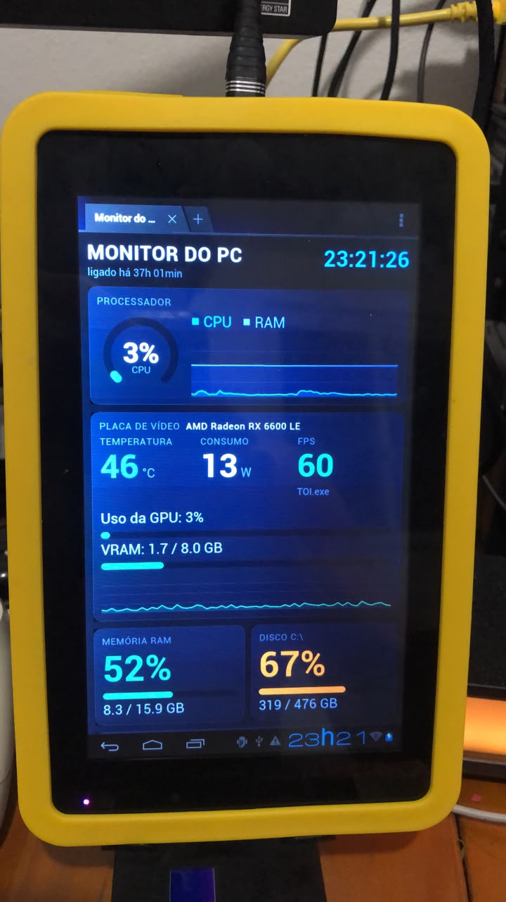

# 📟 Monitor de PC no Tablet Antigo

Transforme um tablet velho (testado em um **Android 4.0**) em um painel de monitoramento do seu PC com Windows: CPU, memória, disco, rede, GPU e FPS, atualizados a cada segundo pelo Wi-Fi.

O projeto nasceu de um tablet educacional do MEC que estava parado. Em vez de comprar um monitor secundário, ele virou um painel de hardware.



> Adicione sua foto em `docs/foto.jpg`. Evite mostrar abas do navegador, IPs ou dados pessoais na imagem.

## ✨ Recursos

- **CPU**: uso total em medidor circular, gráfico dos últimos 60 s e barra por núcleo.
- **Memória RAM e disco**: porcentagem, barras coloridas e GB usados.
- **Rede**: velocidade de download e upload com gráfico.
- **GPU**: temperatura, consumo (W), uso, VRAM e gráfico.
- **FPS** do jogo em execução.
- **Relógio e tempo ligado** do PC.
- **Funciona em navegadores antigos**: o front-end usa só JavaScript ES5, `XMLHttpRequest` e `<canvas>`, sem bibliotecas externas.
- **Um único arquivo** (`monitor.py`), sem instalar nada no tablet.

## 🧠 Como funciona

```
┌──────────────┐   sensores   ┌────────────────────┐   HTTP (JSON)   ┌────────────────┐
│ psutil       │─────────────▶│                    │◀───────────────▶│ Tablet / outro │
│ LibreHW Mon. │   HTTP :8085 │    monitor.py      │   a cada 1 s    │ navegador      │
│ nvidia-smi   │─────────────▶│ (servidor HTTP,    │                 │ (página + JS)  │
│ PresentMon   │   stdout CSV │  porta 8000)       │                 └────────────────┘
└──────────────┘              └────────────────────┘
```

1. O `monitor.py` coleta os dados em *threads* separadas (CPU, rede, GPU e FPS).
2. Um servidor HTTP embutido (`http.server`) entrega a página HTML em `/` e os dados em JSON em `/dados`.
3. A página, no navegador do tablet, consulta `/dados` a cada segundo e desenha tudo no `<canvas>`, sem recarregar a tela.

### De onde vêm os dados

| Dado | Fonte |
|---|---|
| CPU, núcleos, RAM, disco, rede, uptime | [`psutil`](https://github.com/giampaolo/psutil) |
| GPU AMD / Intel (temperatura, consumo, uso, VRAM) | [LibreHardwareMonitor](https://github.com/LibreHardwareMonitor/LibreHardwareMonitor) (servidor web, porta 8085) |
| GPU NVIDIA | `nvidia-smi` (incluído no driver da NVIDIA) |
| FPS | [PresentMon](https://github.com/GameTechDev/PresentMon) |

## 📋 Requisitos

**No PC (Windows 11; deve funcionar no Windows 10):**
- Python 3.8 ou superior
- `psutil` (`pip install psutil`)
- LibreHardwareMonitor (para GPU AMD/Intel)
- PresentMon (opcional, só para o FPS)

**No tablet / dispositivo de exibição:**
- Qualquer navegador com `<canvas>` e `XMLHttpRequest` (inclui o navegador do Android 4.0)
- Estar na **mesma rede** do PC

## 🚀 Instalação

1. **Clone ou baixe** este repositório para uma pasta, por exemplo `C:\monitor`.
2. **Instale a dependência:**
   ```bash
   pip install psutil
   ```
3. **GPU AMD/Intel:** abra o LibreHardwareMonitor **como administrador** e ative em
   *Options → Remote Web Server → Run*. Deixe-o aberto. Para conferir, abra `http://localhost:8085/data.json` no navegador do PC.
4. **FPS (opcional):** baixe o PresentMon na [página de releases](https://github.com/GameTechDev/PresentMon/releases), renomeie para `PresentMon.exe` e coloque em `C:\monitor\`.
5. **Rode como administrador** (necessário para o PresentMon):
   ```bash
   cd C:\monitor
   python monitor.py
   ```
6. **Descubra o IP do PC** com `ipconfig` (campo *Endereço IPv4*).
7. **No tablet**, abra no navegador:
   ```
   http://IP-DO-PC:8000
   ```

## ⚙️ Configuração

As opções ficam no topo do `monitor.py`:

| Variável | Descrição | Padrão |
|---|---|---|
| `PORTA` | Porta do servidor | `8000` |
| `DISCO` | Disco monitorado | `C:\` |
| `LHM_URL` | Endereço do LibreHardwareMonitor | `http://127.0.0.1:8085/data.json` |
| `PRESENTMON` | Caminho do `PresentMon.exe` | `C:\monitor\PresentMon.exe` |
| `JOGO` | Fixa o FPS em um programa (ex.: `"eldenring.exe"`). Vazio detecta sozinho | `""` |
| `N` | Segundos de histórico nos gráficos | `60` |

## 🔧 Solução de problemas

**O tablet não abre a página**
- Confirme que o PC e o tablet estão na mesma rede, e que o IP não mudou.
- Teste `http://localhost:8000` no próprio PC. Se abrir no PC e não no tablet, é rede ou firewall.
- No Windows, mude a rede para **Particular** (Configurações → Rede e Internet) e permita o Python no firewall.
- Se o roteador tiver "isolamento de clientes" ou rede de convidados, use a rede principal.

**Tablet antigo não pega IP no Wi-Fi ("Obtendo endereço IP")**
- Use a rede de 2,4 GHz com segurança **WPA2-PSK (AES)**. Evite WPA3 e modo misto.
- Configure um **IP estático** no tablet (Wi-Fi → modificar rede → opções avançadas).

**GPU mostra o aviso em amarelo**
- AMD/Intel: abra o LibreHardwareMonitor como administrador e ative o *Remote Web Server*.
- NVIDIA: confira se o `nvidia-smi` funciona no terminal.

**FPS aparece como `--`**
- Coloque o `PresentMon.exe` na pasta configurada e rode o terminal como administrador.
- O FPS só aparece com um programa gráfico (jogo) rodando.

**A temperatura ou o consumo não aparecem**
- Abra `http://localhost:8085/data.json`, confira os nomes dos sensores da sua GPU e ajuste a função `le_gpu_lhm()`.

## ⚠️ Segurança

O servidor **não tem autenticação** e escuta em todas as interfaces (`0.0.0.0`). Use apenas em redes domésticas de confiança e não exponha a porta 8000 à internet.

## 🧪 Status dos testes

- ✅ GPU AMD (RX 6600) via LibreHardwareMonitor, Windows 11 e tablet Android 4.0.
- ⚠️ Suporte a GPU NVIDIA (`nvidia-smi`) implementado, mas ainda não testado em hardware real.
- ⚠️ FPS via PresentMon depende da versão do programa e de rodar como administrador.

## 🗺️ Ideias futuras

- Iniciar automaticamente com o Windows
- Temperatura da CPU
- Modo de tela cheia e rotação automática
- Autenticação simples por senha

## 🙏 Créditos

- [psutil](https://github.com/giampaolo/psutil)
- [LibreHardwareMonitor](https://github.com/LibreHardwareMonitor/LibreHardwareMonitor)
- [PresentMon](https://github.com/GameTechDev/PresentMon)

## 📄 Licença

Escolha uma licença (por exemplo, MIT) e adicione um arquivo `LICENSE` ao repositório.